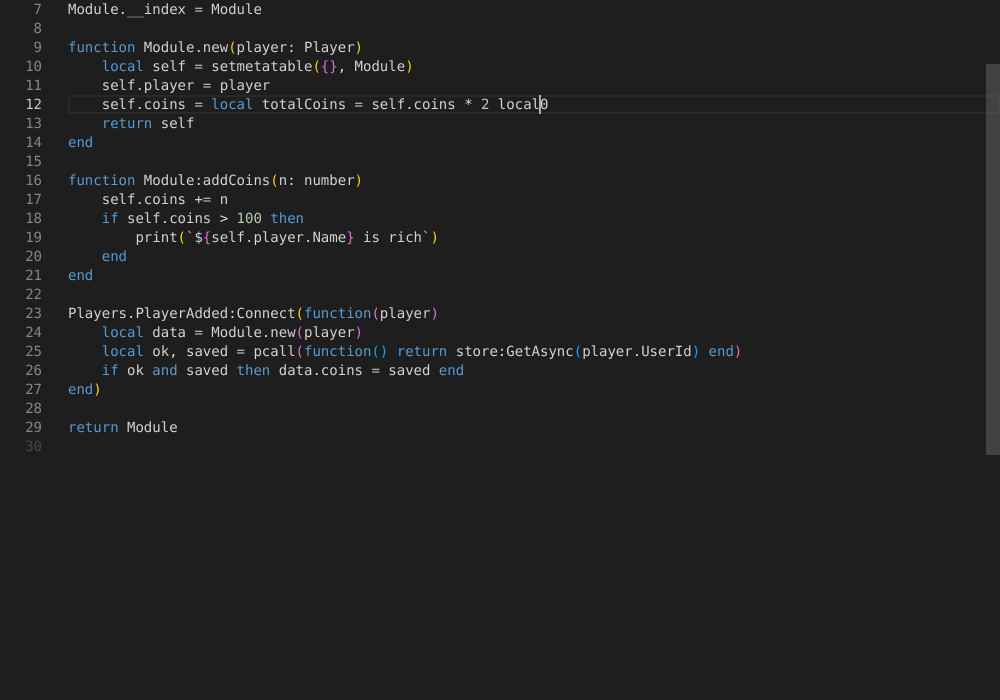
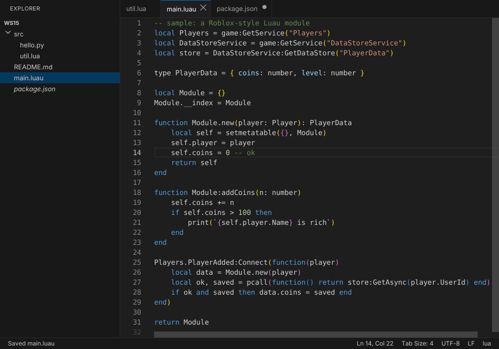

# Spike 15 — a light code editor for Windows XP (Monaco on our engine)

**Direction (owner, 2026-11-22):** go straight to an XP build that runs well on a low-spec machine (Pentium 4 / Athlon XP, 512 MB or more). Not the whole of VS Code: a code editor with
the major languages, file tree and tabs, linting and formatting. Lua/Luau first (the owner writes Roblox code). No VS Code extension API needed: the Claude integration will be the owner's own.

**Chosen design:** Monaco (VS Code's own editor component, the `monaco-editor` npm package) on our engine (06/07: DOM, CSS, layout, style and rasterizer in C; QuickJS-ng host; Win32 window)
with a small shell of our own (file tree, tabs, status bar, quick open, search) instead of the workbench, one window process, tools started when needed.

## Monaco alone on our engine (`host/proto.mjs`)

`host/build_monaco.mjs` bundles `monaco-editor` 0.57.0 (`esm/vs/editor/editor.main.js`: all editor features, the Monarch highlighters of ~80 languages, the language services of
TypeScript/JSON/CSS/HTML inlined) into one IIFE of 10.5 MB and 416 KB of CSS. `host/proto.mjs` loads it into the DOM, opens a 30-line Luau file, types 40 keys through the window's input
path (keydown, char, keyup into `input_driver.js`) and after each key does what the window does on its next tick (animation frames, layout pass, paint with the native rasterizer).

Sandbox (Linux, the same machine as the earlier control benchmarks), headless:

| | Monaco alone | full workbench (spike 14, laptop) |
|---|---|---|
| load: evaluate the bundle, create the editor, stable and painted | 0.75 s (evaluate 0.42 s, create 0.15 s) | 22 s until stable |
| memory (RSS of the one process) | 103 MB loaded, 123 MB after typing; JS heap 111 MB | ~800 MB in 6 to 11 processes, window 250 to 400 MB |
| keystroke, end to end | median 19.9 ms, 90th percentile 21 ms, slowest 32 ms, 1 layout pass per key | median 140 to 180 ms on the laptop |
| elements in the DOM | 358 | 450 to 1,100 |

Found on the way: our painter clips the canvas by `overflow: hidden` on `html`/`body` when those boxes have no height (a browser propagates their overflow to the viewport): the page
came out empty until `html, body` got `height: 100%`. To be fixed in the engine.

## The editor: `host/editor98.mjs` + `app/shell.js`

One process: our DOM/CSS engine, Monaco, and a shell of ~200 lines (`app/shell.js`, `app/shell.css`, VS Code's dark colours):
- **Explorer**: the folder given on the command line, read lazily (a directory is listed when it is opened; `.git`, `node_modules` skipped), sorted folders first.
- **Tabs**: one Monaco model per file, the view state (cursor, scroll, folding) kept per tab; a dot on changed tabs, middle click closes. The language comes from the file name through what Monaco registered (`.luau` is Lua for now).
- **Status bar**: line and column, indentation, encoding, line ends, language, messages.
- **Keys**: Ctrl+S save, Ctrl+W close, Ctrl+P quick open (every file of the folder, the characters of the query in order, matches in blue), Ctrl+B explorer, Ctrl+Tab next tab; Monaco's own (F1 command palette, Ctrl+F find, Ctrl+H replace, Shift+Alt+F format, Ctrl+/ comment, multi-cursor ...).
- **Settings**: `userdata/settings.json` (`fontSize`, `tabSize`, `insertSpaces`, `formatOnSave`).
- Closing a changed tab saves it (there are no dialogs yet).

**Language workers on threads.** Monaco runs the language services of JSON, CSS/SCSS/Less, HTML and TypeScript/JavaScript (validation, formatting, completion, hover) in web workers. `build_monaco.mjs` bundles each worker as an ES module with `worker_prelude.js` in front (self, postMessage/onmessage against `os.Worker.parent`, timers, navigator), and `editor98.mjs` gives Monaco a `Worker` (`QjsWorker`) that is a QuickJS `os.Worker`: a real thread with its own runtime, so a slow TypeScript check does not freeze typing. On Windows our event loop's hooks (pipes, child processes, the window: `winhook.h`, `patch_libc.py`) now belong to the thread that registered them; a worker thread runs the stock loop.

Headless test (`tests/smoke.mjs`, sandbox): ready in 0.6 s (Monaco loaded at 0.4 s); open a folder in the explorer 32 ms, open a file 90 to 150 ms; typing about 50 ms a key in this test (it waits for the page to settle after each key, the proto's 20 ms is the cost itself); save 40 ms (the file on disk changed); quick open 60 ms; open `package.json` from it 65 ms; format JSON through the worker 340 ms (first use, the worker starts).

## Windows XP

- **The host loads on XP** (statically checked): `build_win.sh` with `WINVER=0x0501` force-includes `xp98_compat.h`, which renames QuickJS's Vista calls (`InitOnceExecuteOnce`, condition variables) to stand-ins in `xp98_compat.c` (a one-time flag; a semaphore-and-counter condition variable); `strtok_s` (not in XP's msvcrt) replaced by a local tokenizer; `WM_MOUSEHWHEEL` defined. The executable imports 231 functions, all present in XP SP3's kernel32, user32, gdi32, psapi, shell32, winmm and msvcrt; PE subsystem version 4.0; job objects and DPI awareness are looked up at run time. Not yet run on an XP machine.
- **Package**: `host/package_editor.sh` → `editor98.exe` (2.3 MB, i586 without SSE), `js/` (6 MB), `monaco/` (28 MB: the editor 10.5 MB, the TypeScript worker 13 MB, the others 0.6 to 1.9 MB), `fonts/` (Inter, DejaVu Sans and Sans Mono, 4 MB), `sample/`, `run-editor.cmd`: 40 MB, a 9 MB zip (the VS Code package was 322 MB).
- **Wine is not usable in this sandbox any more** (the cloud container was replaced on 2026-11-22: `wineserver` aborts with `sock_init: shutdown() causes EOF` and `free(): invalid pointer`, for `cmd /c echo` too, 32 and 64 bit). Windows runs happen on the owner's machines until that changes.

## Build 3: Luau, linting, search (2026-11-22)

The owner's build 2 report: no freeze any more, editing works (the fix: `os.Worker` threads made their context with the same function as the main thread, which also set up our modules and took the event loop's hooks; now only the main thread does, `build_win.sh`/`build.sh` `spike98_main_thread`).

- **Luau** (`app/luau.js`), for `.luau` and `.lua` (Luau is a superset of Lua 5.1): a Monarch tokenizer with Luau's syntax (type annotations after `:`/`->`/`::`, `type`/`export type`, `continue`, compound assignment, `//`, backtick strings with `{interpolation}`, long strings and comments with `=` levels, `0b`/`1_000` numbers; Roblox and Lua globals and function calls coloured), auto-indent rules, and a theme `editor98-dark` (VS Code Dark+ colours for control flow, functions, types, globals).
- **Formatter** (Shift+Alt+F, or `formatOnSave`): re-indents by block structure (a line is indented once for every earlier line that still has an unclosed opener: `function`/`then`/`do`/`repeat`/brackets; `end`/`until`/`else`/`elseif`/closing brackets at the start of a line come back), Luau's if-expressions (`x = if a then b else c`, no `end`) recognised by the token before `if`, lines inside long strings and comments untouched, trailing spaces removed. Not StyLua (Rust: Rust programs do not run on XP): no line wrapping or spacing changes. Oracle `tests/luau_format_oracle.mjs` over Luau's own test suite (57 files, 16,975 lines): only whitespace changes, a second run changes nothing, long strings are byte for byte the same: 0 files with a problem; 45 ms for all of it.
- **Linting** with Luau's own type checker and linter, `luau-analyze` (`host/build_luau_analyze.sh`: Luau release 748, cross-built for XP like the host; libstdc++'s Vista calls (condition variables, `GetThreadId`) redirected to `11-windows-host/host/xp98_compat.c` through `xp98_imp.c`, which defines the import pointers those objects call; 7 MB; imports only XP SP3 functions) with `host/patch_luau_analyze.py`: `--definitions=` (Roblox's API from luau-lsp's `globalTypes.None.d.luau`, MIT; `LuauTarjanChildLimit` raised to 15,000 as luau-lsp does, or the 700 KB of definitions do not check) and `--server` (one process for the session: a file path per line on stdin, its problems and `@@END` on stdout; the definitions are read once, 0.5 to 0.6 s, then a check takes about 1 ms on the sandbox). The editor writes the buffer and a `.luaurc` (the project's own nearest `.luaurc` merged in, Roblox's globals added) to `userdata/lint/` after 0.8 s without typing, on open and on save; problems are squiggles and a count in the status bar. Settings `lint` (on), `luauMode` (`nonstrict`, as Roblox Studio; a file's `--!strict` still applies).
- **Search across the folder** (Ctrl+Shift+F, Escape back to the explorer, Ctrl+Shift+E): plain text (case-insensitive) or `/regex/flags`, text files under 1 MB, open tabs searched as edited, at most 2,000 matches, a click opens the match selected.
- Package: `tools/` (luau-analyze.exe, roblox.d.luau, licences) and `run-editor.cmd --tools`.

## Build 4: save prompts, Open Folder, Open File, New File, Save As (2026-11-22)

- **Dialogs of Windows itself** in the host (`11-windows-host/host/winwin.c`, `spike:win`): `messageBox` (MessageBoxW), `pickFolder` (SHBrowseForFolderW with the new-style dialog and an edit box, starting in the open folder), `openFileDialog` / `saveFileDialog` (GetOpenFileNameW / GetSaveFileNameW, which asks before overwriting). All modal to the editor window, all present on XP (comdlg32, shell32, ole32 added; `check_imports.sh` clean). While one is open the window's events do not reach JavaScript (`g_modal`): the dialog runs its own message loop inside the call that opened it. A press that opened a dialog gets its release afterwards (`window_host98.mjs` `afterModal`), or the page would go on dragging a selection.
- **Unsaved changes are never lost silently** (build 3 saved them without asking): closing a changed tab asks Save / Don't Save / Cancel (VS Code's wording); closing the window (`openWindow` option `canClose`) or opening another folder asks once for all changed files ("the following 3 files"); Cancel keeps everything as it was. Save on an untitled tab asks where (Save As), and cancelling that cancels the close.
- **Folders and files**: Open Folder (Ctrl+K Ctrl+O, the folder button in the explorer header, F1 "File: Open Folder..."), Open File (Ctrl+O), New File (Ctrl+N, an untitled tab; the language follows the name given at Save As), Save As (Ctrl+Shift+S), Save All (Ctrl+K S), Refresh and Collapse All buttons. The folder open when the editor closes is reopened next time (`userdata/state.json`); `run-editor.cmd` with no argument uses it, the first time `sample`.
- Headless test `runDialogs` in `tests/smoke.mjs`, answering the dialogs from a script (`globalThis.__dialog98`): Cancel keeps a changed tab; Don't Save closes it and leaves the file as it was; an untitled tab closed with Save goes through Save As to a new file that appears in the tree; the window close with three changed files and Cancel stays open; Open Folder with Don't Save closes the tabs and shows the new folder.

## Build 5: speed (2026-11-23)

The owner's report on build 4: everything works, but typing and navigation are slow. Measured first (`tests/perf.mjs`: each input split into the handler, the frames it asked for, style + layout, and paint; median and 90th percentile; sandbox, one core, `taskset -c 0`), then profiled (`QJS98_PROFILE=1`):

- Two thirds of a keystroke was **laying out the whole document again** (217 elements for one changed line), twice per key (once inside the text control's input handling, once in Monaco's render frame), up to six times when the suggestion widget appeared.
- **Incremental layout** (`06-rendering/host/dom/layout_incremental.js`): a pass whose changes all sit inside "layout roots" lays out only those subtrees, each alone inside a stand-in for its containing block, and grafts them into the previous layout; ancestors' scroll extents are recomputed exactly as `layout.c` does. A root is a positioned box whose layout nothing outside depends on (out of flow; or in flow with a block formatting context, a px width and an unchanged size), or a container whose children are all absolutely positioned (Monaco's lines, overlays, line numbers and cursors: a new or changed child is laid out alone). Anything else falls back to a full layout. Oracle: `__verifyIncLayout98` compares every incremental pass with a full layout box by box (positions, sizes, scroll extents, text fragments, inline rectangles, children); `tests/inc_layout_fuzz.mjs` drives it with random trees (absolute, relative, fixed, flex, overflow, inline, text) and random mutations. The fuzz found eight real differences (all fixed: boxes under inline boxes, which `layout.c` never positions; own-changed boxes judged by their old style; shrink-to-fit ancestors; containing blocks that are inline boxes; ...). Layout only: 19 of 20 seeds x 10,000 steps clean (the 20th found the last layout bug: fixed, that seed rerun clean); on the final code with partial frames and scrolling: seeds of 4,000 steps, 0 differences in the 3 finished when build 5 was sent; plus the editor scenario.
- **Partial frames** (`06-rendering/host/dom/damage.js`, `07-native-render/host/frame98.js`): the window repaints and presents only the rectangles that changed (the old and new extent of each regrafted subtree, restyled boxes whose values changed, text controls, scrolled boxes), and `paint.js` skips boxes, stacking items and text outside them, using per-box paint bounds kept across frames. Oracle `__verifyDamage98`: every partial frame is also painted in full and compared pixel by pixel (0 differences over about 2,000 fuzz frames, with scrolling, and the editor scenario).
- **Paint after input** (`window_host98.mjs` `inputFirst`): the frame after a key or click is painted as soon as the input is handled, not at the next tick after the paint gap (up to 33 ms plus three times the last paint's cost).
- Smaller: an identity transform (Monaco's `translate3d(0,0,0)` layers) no longer sends `getBoundingClientRect` and hit testing down the slow path (click in text 25 -> 18 ms); the status bar and tab row sit in absolutely positioned rows; unchanged status text is not set again; `editor.layout()` only on a size change; a typed-in text control scrolls its caret into view at the next layout pass instead of forcing one.
- **Font fallback bug**: with the package's fonts (Inter, DejaVu Sans / Sans Mono only), a family with no installed match (Monaco's `Arial`, mapped to Liberation Sans) fell back to DejaVu Serif, which the package does not ship: no font, and the layout pass threw. In the window such errors are caught, so the pass was lost rather than the program. The fallback now picks the closest shipped font by kind. The sandbox runs had not used the package's font folder; `run.sh` does now.

Sandbox, one core, median / 90th percentile (ms):

| input | build 4 | build 5 |
|---|---|---|
| type a letter | 26 / 75 | 12.4 / 12.9 |
| arrow down | 4.7 / 19 | 0.6 / 14 |
| arrow right | 4.7 / 4.8 | 0.5 / 0.6 |
| page down/up | 18 / 19 | 14.5 / 22 |
| wheel | 8 / 31 | 1.0 / 17 |
| click in text | 43 / 45 | 19 / 22 |
| switch tab | 117 / 187 | 92 / 153 |

The owner's machines are 2.4 to 3.4 times slower than the sandbox (Windows 7 laptop, measured earlier) and a P4 more; these are estimates until the build 5 logs come back (`results\editor.txt` has a `[latency]` line per input). Left: switching tabs (Monaco renders the new model with several layout passes that read geometry), Monaco's own work per key (~6 ms), the restyle planning per pass.

## Build 6: the rest of the speed list (2026-11-23)

Not yet run by the owner (build 5 was not tested in between). Sandbox numbers; the one-core figures (`taskset -c 0`) include Monaco's worker threads competing with the window thread, as on a single-core P4; main-thread changes were compared on four cores, where a key is a steady 7.9 ms (one core: 13 to 22 ms, in steps of a 4 ms time slice).

- **Background work per key** (measured as total process CPU per typed key, all threads, one core, a 17,786-line Luau file): 136 -> 39 ms. Monaco asked its worker on every key to gather every word of the document for suggestions (`textualSuggest`) and scanned the document for color values. Now `quickSuggestionsDelay` is 400 ms in files over 2,000 lines (50 ms otherwise: suggestions still come, once typing pauses) and `defaultColorDecorators: 'never'` (CSS keeps its own color provider). `settings.json` `"editor"` passes any Monaco option through; explicit values win.
- **Priorities on Windows**: `os.Worker` threads run at `THREAD_PRIORITY_BELOW_NORMAL` (`11-windows-host/host/patch_libc.py`), `luau-analyze --server` at `BELOW_NORMAL_PRIORITY_CLASS` (`patch_luau_analyze.py`): on a single core the window's work comes first.
- **Tab switching** (`app/shell.js`): one Monaco editor per recently used tab (pool of `settings.editors`, default 4), each in its own pane; switching shows another pane instead of rendering the other file again. Switch 85 -> 26 ms median (four cores); a switch to a recycled editor still ~90 ms; the first four opens create an editor (open a file 51 -> 87 ms). Memory after six files with four editors: 161 MB resident on the 64-bit sandbox (89 MB after start).
- **Start**: `monaco.mjs` is an ES module compiled through the module loader's bytecode cache (`userdata/code-cache`); Monaco loads in 110 instead of 490 ms, ready 710 -> 325 ms (one core). The package ships the cache, made by one headless start of the package's own tree with the Linux host; it is read from another install folder in the test. Whether the Windows build reads a cache made on Linux is untested: one it cannot read is compiled again and replaced.
- **Engine**: restyle planning memoizes `isConnected` and collects only the `:has()` keys its index holds; the element count is recounted only when the "too many dirty elements" test needs it (it had walked every element on each pass with insertions); `syncFrames` looks at the iframes layout built boxes for instead of every box; `__rawRect` without copies; damage of restyled boxes compares only paint properties; `user-select` read from the last resolved style (a press on a tab had laid out the whole switch to read it), and the shell's chrome is `user-select: none`; tree and tabs update classes in place. Oracles after these: style fuzz (300 seeds x 25 steps) 0 mismatches, `__verifyStyles` / layout / paint oracles in the editor scenario 0 differences.
- Tried and reverted: a memo of computed styles for identical inputs (no measurable gain); the collector at idle moments is on (as in the desktop build) though no difference showed on the sandbox.

Sandbox, four cores, median / 90th percentile (ms): type a letter 12.6 / 15.6, page down/up 13.6 / 17.3, click in text 18.8 / 20.5, switch tab 25.6 / 123, open a file 88 / 101.
- **Two partial-paint bugs found and fixed while testing build 6** (the randomised test, now painting after every step and with a new oracle `--fuzz-offsets` that compares the offset paint.js used for every box with the one damage.js computes): damage placed boxes under nested scrolled boxes by CSS's containing-block chain, while paint.js applies the scroll of each box on the path from the stacking context root whose clip applies (`stacking.js clipApplies`): damage now uses paint's rule. And a zero-width line rectangle of a bordered inline box still paints its borders: inline rectangles now count with their borders and padding. After both: 12 seeds x 2,000 steps, layout, offsets and pixels compared after every step, 0 differences.

